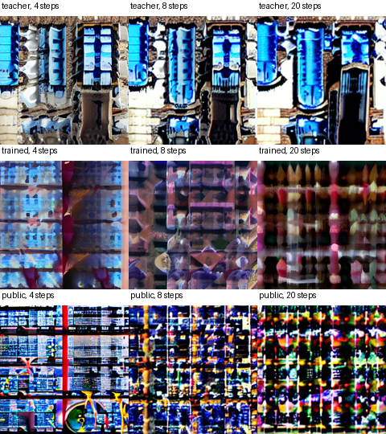

# Few-step diffusion distillation on a single GPU

Measure the tradeoff between sampling steps, teacher agreement, end-to-end latency and peak allocated GPU memory using one SD 1.5 base, the public LCM-LoRA and a separately trained rank-two adapter.

```powershell
python -m pip install -r requirements.txt
python run.py demo
python run.py reproduce
python run.py evaluate
python -m unittest discover -s tests
```

Use Python 3.11. The default device is CUDA if available. To reuse a local FP16 model and public adapter, supply `--base-path <sd15-directory> --adapter-path <lcm-directory>`. `--out` selects a separate experiment directory.



## Measured result

On the RTX 4060 Laptop, the 20-step teacher took a median 2.774 s. The four-step public and local adapters took 0.638 s and 0.655 s. Their mean pixel MSE to the matched 20-step teacher was 0.1633 and 0.1263, respectively. The four-step DDIM baseline reached 0.0799, so neither adapter improved this teacher-agreement measure. At 256 px with guidance fixed to 1.0, the example bicycle is barely identifiable in several outputs. The demo additionally compares 512 px sampling with the teacher's conventional CFG and reports the guidance per arm. Its images are separate from the controlled timing benchmark.

[All nine settings and peak memory](results/summary.csv) · [54 individual measurements](results/measurements.json) · [32 training losses and reload check](results/training.json)

## Protocol

- Fixed LCM/DDIM solver and boundary formulas from the Hugging Face implementation. Training uses a frozen teacher, online LoRA predictions and a detached student target at the previous timestep. Six bundled photographs from scikit-image and their explicit captions supply training latents.
- The default budget is 32 single-image updates at 256×256. We record the loss trace, parameter update norm and checkpoint reload. Three held-out prompts, two noise seeds and three step counts are crossed with all three methods.
- Every arm runs an untimed warm-up. Latency covers synchronized prompt encoding, denoising and decoding. Images are written after timing. The report uses the median and empirical 95th percentile across six requests per setting. Peak memory is PyTorch allocated memory, in bytes.
- The quality metric is pixel MSE to the matched 20-step DDIM teacher output. This measures agreement with a reference trajectory; the prompts and images are provided for visual review. Step counts, dimensions, reference seed and guidance for the comparisons are recorded explicitly in [the config](configs/protocol.json) and [experiment module](src/runner.py).

[Upstream](UPSTREAM.md) · [Handoff and latest verified stage](HANDOFF.md)
